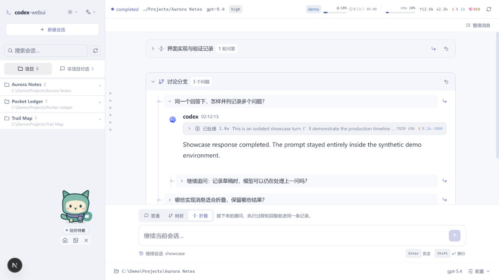

<p align="center">
  
</p>

<h1 align="center">Codex Web UI</h1>

<p align="center">
  <strong>A local workspace for long Codex conversations</strong><br />
  Follow up in branches, fold finished work, and pick up where you left off.
</p>

<p align="center">
  <a href="#quick-start">Quick start</a> &nbsp;·&nbsp;
  <a href="#local-demo">Local demo</a> &nbsp;·&nbsp;
  <a href="./DEVELOPMENT.md">Development</a> &nbsp;·&nbsp;
  <a href="./README.zh-CN.md">简体中文</a>
</p>

<picture>
  <source media="(prefers-color-scheme: dark)" srcset="./docs/readme/workspace-dark.jpg" />
  
</picture>

<p align="center"><sub>Captured from the local demo with fictional data. <a href="./docs/readme/workspace-dark.jpg">Dark</a> / <a href="./docs/readme/workspace-light.jpg">Light</a></sub></p>

## One session, three views

| Mode | What you can do |
| :--- | :--- |
| **Normal** | Follow prompts, replies, and execution events in order. |
| **Tree** | Draft several sibling questions, send them one at a time, and nest a follow-up under the answer it refers to. |
| **Folded** | Keep the prompt, execution, and final reply together in a compact record. Expand it or continue it when needed. |

The views share one Codex session. The browser remembers each session’s groups, collapsed state, and unsent drafts.

## Quick start

Use **Node.js 18.18+** and an authenticated [Codex CLI](https://github.com/openai/codex). If you need to set up the CLI, run these commands.

```bash
npm install -g @openai/codex
codex login
```

In a checkout of this version, install the locked dependencies and start the app.

```bash
npm ci
npm run dev
```

Open [http://127.0.0.1:3000](http://127.0.0.1:3000), choose a working directory, and send a prompt. On Windows PowerShell, use `npm.cmd` if the shell blocks `npm.ps1`.

<details>
<summary>Production and alternate ports</summary>

```bash
npm run build
npm start
```

The default port is 3000. If it is occupied, use `npm run dev -- --port 3001` or `npm start -- --port 3001` and open the matching local URL.

</details>

## Organize a conversation

1. Pick **Normal**, **Tree**, or **Folded** above the composer to set the display mode for upcoming turns.
2. In **Tree**, press Enter to record a question, then edit and send drafts individually. Use **Add sibling questions** or **Follow up here** to set where the next question appears.
3. In **Folded**, click a record’s title to open it or choose **Continue this record** to append a turn.
4. To reorganize existing turns, click **Organize messages** and select the first and last turn. The editor includes the complete range. Give the group an optional title and choose tree or folded display. **Restore normal display** ungroups the turns and preserves the messages.

### Follow the work

- **Live activity** streams answers, commands, file changes, tool calls, and plans. Expand a process summary to inspect the steps or open a file change to view and copy its diff.
- **History** lets you browse, replay, and resume Codex sessions, including compressed `.jsonl.zst` archives. Use the message rail to jump to a turn.
- **Controls** include model, reasoning effort, collaboration mode, sandbox, approval policy, and working directory. Type `/` for commands or `@` for skills. In **Plan** mode, answer structured questions in the timeline.
- **Reading** supports Markdown, syntax highlighting, LaTeX, and image previews. The interface offers light, dark, and system themes plus English and Simplified Chinese. On narrow screens, open the sidebar from the top-left button and expand **Settings** below the composer.

### Bring the companion along

The companion animates while a turn runs, shows when the task needs attention, and briefly celebrates completion. Drag it to move it or use arrow keys when focused. Hide it with its close button and restore it with **Show companion**. The browser remembers its position and visibility and respects reduced motion.

Import a local PNG or WebP sprite sheet for the current page visit. The accepted sizes are **1536 × 1872 (v1)** and **1536 × 2288 (v2)**, up to **20 MiB**. [Sprite format and controls](./docs/pet-research.md)

## Local demo

Once the app is running, open [http://127.0.0.1:3000/showcase](http://127.0.0.1:3000/showcase). The demo uses the same interface with fictional projects, session history, and simulated replies supplied in the browser. You can try the three views and the companion using the demo data alone.

## Configuration and help

The web server binds to `127.0.0.1` for local, single-user use. The browser talks to the local Next.js server, which runs `codex app-server` for live turns and reads Codex rollout files for replay.

| Variable in `.env.local` | When to set it |
| :--- | :--- |
| `CODEX_BIN` | Point to the absolute path of the real Codex executable if detection fails. |
| `CODEX_JS` | Point to the absolute path of `@openai/codex/bin/codex.js` to use the Node launcher. |
| `CODEX_HOME` | Use a different Codex data directory. The default is `~/.codex`. |

If the app cannot find Codex, run `codex --version` in the same shell used to start it, or set `CODEX_BIN`. For binary resolution, session data flow, API boundaries, and contributor commands, see the [development guide](./DEVELOPMENT.md).

---

**v0.1.1** · [MIT License](./LICENSE) · [Third-party notices](./THIRD_PARTY_NOTICES.md)

Independent community project. OpenAI and Codex names and marks belong to OpenAI.
