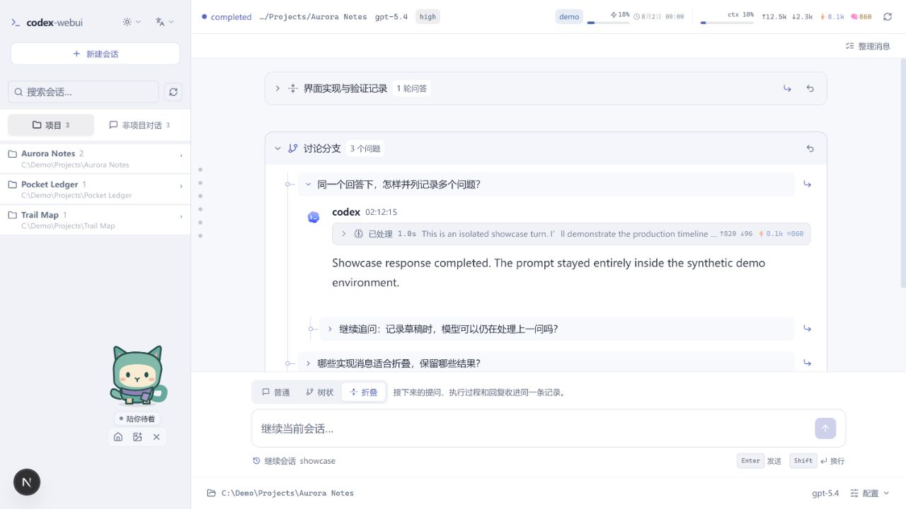

<p align="center">
  
</p>

<h1 align="center">Codex Web UI</h1>

<p align="center">
  <strong>用浏览器整理和续接 Codex 长对话</strong><br />
  分支追问、收起执行过程，随时回到上次做到的地方。
</p>

<p align="center">
  <a href="#快速开始">快速开始</a> &nbsp;·&nbsp;
  <a href="#本地演示">本地演示</a> &nbsp;·&nbsp;
  <a href="./DEVELOPMENT.md">开发说明</a> &nbsp;·&nbsp;
  <a href="./README.md">English</a>
</p>

<picture>
  <source media="(prefers-color-scheme: dark)" srcset="./docs/readme/workspace-dark.jpg" />
  
</picture>

<p align="center"><sub>截图来自本地演示，使用虚构数据。<a href="./docs/readme/workspace-dark.jpg">深色</a> / <a href="./docs/readme/workspace-light.jpg">浅色</a></sub></p>

## 同一会话，三种视图

| 模式 | 适合做什么 |
| :--- | :--- |
| **普通** | 按时间顺序跟进提问、回复和执行过程。 |
| **树状** | 先记录多个并列问题，再逐个发送，也可以对某个回答继续嵌套追问。 |
| **折叠** | 把提问、执行和最终回复收进一条记录，需要时展开查看或继续追加。 |

三种视图共用同一个 Codex 会话。浏览器会按会话记住分组、展开状态和未发送的草稿。

## 快速开始

需要 **Node.js 18.18+** 和已登录的 [Codex CLI](https://github.com/openai/codex)。如需安装 CLI，可执行以下命令。

```bash
npm install -g @openai/codex
codex login
```

在当前版本的项目目录中安装依赖并启动。

```bash
npm ci
npm run dev
```

打开 [http://127.0.0.1:3000](http://127.0.0.1:3000)，选择工作目录后发送消息。如果 Windows PowerShell 拦截 `npm.ps1`，可以用 `npm.cmd` 执行相同命令。

<details>
<summary>生产模式和端口切换</summary>

```bash
npm run build
npm start
```

默认端口为 3000。若端口被占用，可运行 `npm run dev -- --port 3001` 或 `npm start -- --port 3001`，再打开对应的本地地址。

</details>

## 整理对话

1. 在输入区上方选择 **普通**、**树状** 或 **折叠**，为接下来的问答设置显示方式。
2. 在 **树状** 模式下按 Enter 记录问题，再编辑草稿并逐个发送。用 **添加并列问题** 或 **追问此问题** 选择新问题显示的位置。
3. 在 **折叠** 模式下，点击记录标题可展开，点击 **继续此记录** 可追加新一轮问答。
4. 要整理已有问答，点击 **整理消息** 并选定起止轮次，编辑器会自动选中整个区间。可填写标题，再选择树状或折叠显示。**恢复普通显示** 可解除分组并保留消息。

### 跟进执行

- **实时过程**会显示回答、命令、文件变更、工具调用和计划。可展开过程摘要查看步骤，或打开文件变更查看和复制 diff。
- **历史会话**可浏览、回放和续接，支持压缩的 `.jsonl.zst` 归档。用消息导航可跳到指定轮次。
- **会话配置**包括模型、推理强度、协作模式、沙箱、审批策略和工作目录。输入 `/` 查找命令，输入 `@` 查找技能。**Plan** 模式中的结构化提问可直接在时间线上回答。
- **阅读体验**支持 Markdown、代码高亮、LaTeX 和图片预览，可切换浅色、深色或跟随系统，也可切换简体中文和英语。窄屏上可通过左上角按钮打开侧栏，并在输入区下方展开**配置**。

### 网页桌宠

桌宠会在任务运行时活动，需要你处理时给出提示，完成后短暂庆祝。可拖动它，或聚焦后用方向键移动。关闭后点 **显示桌宠** 即可恢复。位置和显示状态由浏览器保存，动效遵循系统的减少动态效果设置。

也可以导入本地 PNG 或 WebP 精灵图供本次访问使用。支持 **1536 × 1872（v1）** 和 **1536 × 2288（v2）**，大小不超过 **20 MiB**。[精灵图格式与操作说明](./docs/pet-research.md)

## 本地演示

启动应用后打开 [http://127.0.0.1:3000/showcase](http://127.0.0.1:3000/showcase)。这里用同一套界面呈现虚构项目、会话历史和浏览器内模拟回复，可以直接试用三种显示方式和桌宠。

## 配置与帮助

Web 服务绑定 `127.0.0.1`，供本地单用户使用。浏览器连接本机 Next.js 服务，由它启动 `codex app-server` 执行实时任务，并读取 Codex 的 rollout 文件来回放历史。

| `.env.local` 变量 | 何时设置 |
| :--- | :--- |
| `CODEX_BIN` | 自动查找失败时，指定真实 Codex 可执行文件的绝对路径。 |
| `CODEX_JS` | 使用 Node 启动器时，指定 `@openai/codex/bin/codex.js` 的绝对路径。 |
| `CODEX_HOME` | 使用其他 Codex 数据目录时设置，默认为 `~/.codex`。 |

如果界面找不到 Codex，请在启动应用的同一个 shell 中运行 `codex --version` 确认，或设置 `CODEX_BIN`。二进制解析、会话数据流、API 边界和开发命令见[开发说明](./DEVELOPMENT.md)。

---

**v0.1.1** · [MIT 协议](./LICENSE) · [第三方声明](./THIRD_PARTY_NOTICES.md)

本项目由社区独立维护。OpenAI 与 Codex 的名称和标识归 OpenAI 所有。
